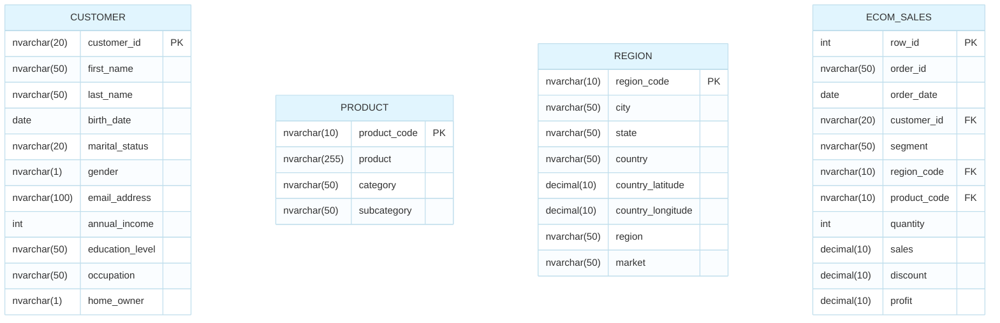

### 1. 🗺️ Data Schema (Sơ đồ dữ liệu)

*(Bạn có thể giữ lại sơ đồ chạy bằng code Mermaid hoặc dùng ảnh tùy thích. Dưới đây là bản Mermaid đã được bổ sung đầy đủ các đường nối)*:


--- 

### 2. 📖 Data Dictionary (Từ điển dữ liệu): Bảng `region`

| Tên cột | Kiểu dữ liệu | Ràng buộc | Mô tả (Ý nghĩa kinh doanh) |
| --- | --- | --- | --- |
| **region_code** | `nvarchar(10)` | **Khóa chính (PK)** | Mã định danh duy nhất cho từng khu vực/vùng địa lý |
| **city** | `nvarchar(50)` | Null | Tên thành phố |
| **state** | `nvarchar(50)` | Null | Tên bang/tỉnh thành |
| **country** | `nvarchar(50)` | Null | Tên quốc gia |
| **country_latitude** | `decimal(10,6)` | Null | Vĩ độ của quốc gia (Dùng để vẽ biểu đồ bản đồ) |
| **country_longitude** | `decimal(10,6)` | Null | Kinh độ của quốc gia (Dùng để vẽ biểu đồ bản đồ) |
| **region** | `nvarchar(50)` | Null | Khu vực cụ thể (Ví dụ: Đông Nam Á, Bắc Mỹ...) |
| **market** | `nvarchar(50)` | Null | Phân khúc thị trường rộng lớn hơn (Ví dụ: Châu Á Thái Bình Dương - APAC) |

```
```